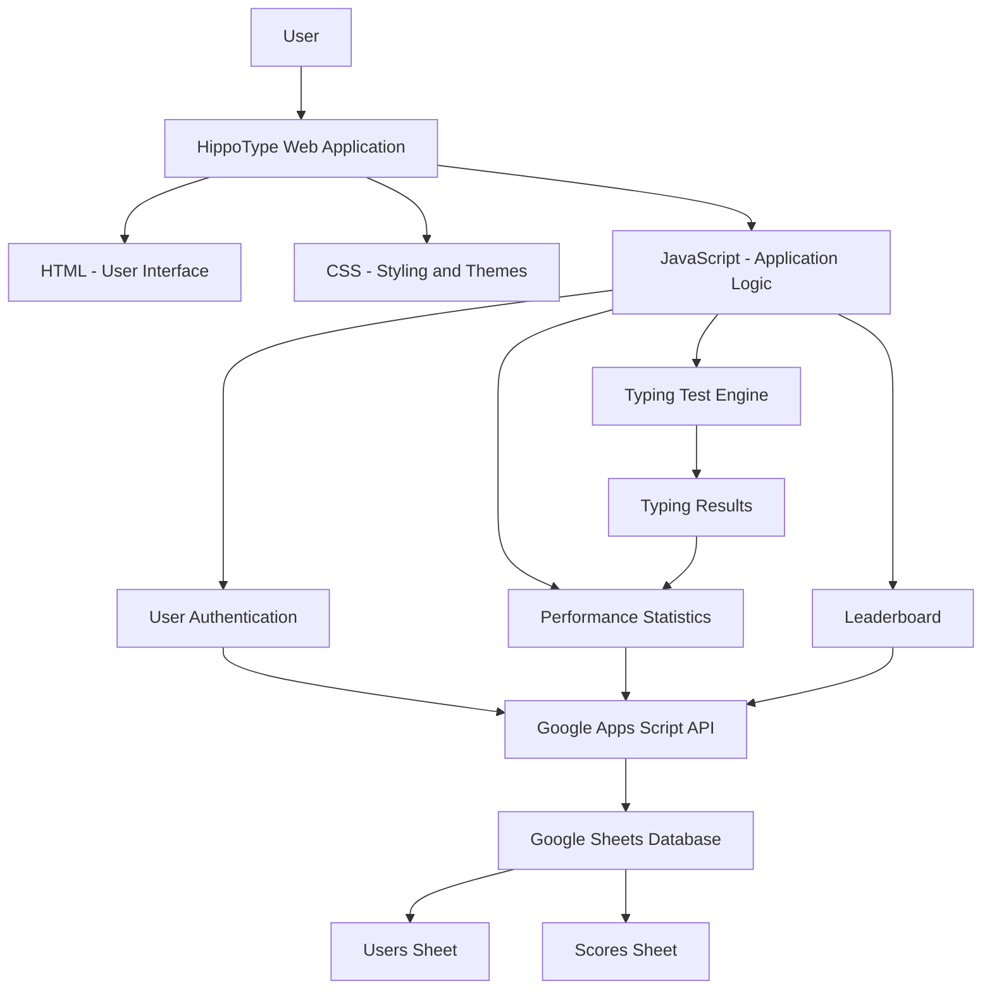
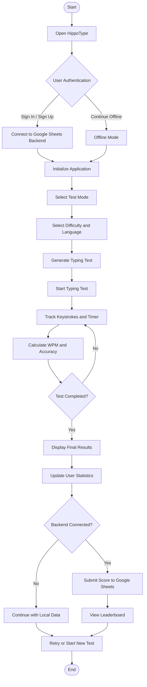

# HippoType – Minimalist Speed Typing Test

**A modern, minimalist, and interactive typing speed test application designed to improve typing speed, accuracy, consistency, and overall typing skills.**

HippoType is a browser-based typing test application that allows users to practice typing through meaningful sentences, programming code snippets, and stenography exercises. It provides real-time performance statistics, multiple difficulty levels, adaptive difficulty, and a leaderboard to make typing practice more engaging.

Built using **HTML, CSS, JavaScript, Google Apps Script, and Google Sheets**, the application combines an interactive frontend with an optional cloud-based backend for user accounts, score storage, and leaderboard management.

The project is designed to demonstrate practical concepts of **Web Development, JavaScript Programming, User Interface Design, Database Integration, and Cloud-Based Application Development**.

---

## Table of Contents

- [1. Project Overview](#1-project-overview)
- [2. Key Features](#2-key-features)
- [3. System Architecture](#3-system-architecture)
- [4. End-to-End Workflow](#4-end-to-end-workflow)
- [5. Typing Test and Performance Calculation](#5-typing-test-and-performance-calculation)
- [6. User Authentication and Data Management](#6-user-authentication-and-data-management)
- [7. Leaderboard System](#7-leaderboard-system)
- [8. Technology Stack](#8-technology-stack)
- [9. Project Structure](#9-project-structure)
- [10. Installation and Setup](#10-installation-and-setup)
- [11. Running the Application](#11-running-the-application)
- [12. Offline Mode](#12-offline-mode)
- [13. Future Enhancements](#13-future-enhancements)
- [14. Agile Software Development and DevOps Integration](#14-agile-software-development-and-devops-integration)

---

## 1. Project Overview

Traditional typing practice often involves repeatedly typing random words or paragraphs without receiving detailed performance feedback.

Users may find it difficult to measure their typing speed, identify mistakes, track improvement, and remain motivated to practice regularly.

**HippoType** addresses these problems by providing an interactive typing environment with real-time feedback and performance tracking.

The application allows users to:

1. Register or sign in to the application.
2. Continue using the application in offline mode.
3. Select a typing test mode and duration.
4. Choose a difficulty level and language.
5. Practice with meaningful sentences or programming code snippets.
6. Monitor typing speed, accuracy, errors, and streaks in real time.
7. View their test results and performance statistics.
8. Save completed test scores to Google Sheets when the backend is connected.
9. Compare performance through the leaderboard.
10. Customize the application using different themes and settings.

The application can operate without a Google Sheets backend, while connecting the backend enables cloud-based account and leaderboard functionality.

---

## 2. Key Features

| Feature | Description |
|---|---|
| Multiple Test Modes | Supports 15s, 30s, 60s, 120s, 25w, 50w, 100w, and Zen modes. |
| Multiple Difficulty Levels | Provides Easy, Medium, Hard, and Expert difficulty levels. |
| Multiple Languages | Supports English, Spanish, French, German, Code, and Stenography. |
| Programming Practice | Allows users to practice programming snippets in C, C++, Python, Java, and React. |
| Live WPM | Displays words per minute during the typing test. |
| Live Accuracy | Calculates and displays typing accuracy. |
| Error Tracking | Tracks incorrect characters and typing mistakes. |
| Streak and Combo | Tracks consecutive correct typing and maximum combo. |
| Adaptive Difficulty | Automatically adjusts difficulty based on typing performance when enabled. |
| Stenography Mode | Provides a dedicated typing input and SPM measurement for stenography practice. |
| Custom Text | Allows users to practice with their own text. |
| Leaderboard | Displays the top typing performances. |
| User Authentication | Supports registration and login through the Google Sheets backend. |
| Offline Mode | Allows users to use the typing application without backend connectivity. |
| Performance Statistics | Tracks best WPM, average WPM, accuracy, and total tests. |
| Achievements | Provides achievement milestones for typing performance. |
| Multiple Themes | Includes Ocean, Dark, Forest, Sunset, and Matrix themes. |
| Settings | Allows users to customize preferences and manage their statistics. |
| WPM Chart | Displays typing performance during a test. |

---

## 3. System Architecture

HippoType follows a simple client-server architecture.

The frontend is developed using HTML, CSS, and JavaScript. Google Apps Script acts as the backend API, while Google Sheets is used as the database for storing user information and typing scores.

### Architecture Diagram



### Major Components

- **Presentation Layer:** HTML provides the structure and interface of the application.
- **Styling Layer:** CSS controls the appearance, themes, animations, and responsive layout.
- **Application Logic Layer:** JavaScript manages typing tests, timers, calculations, settings, and user interactions.
- **Backend Layer:** Google Apps Script processes authentication, score submission, and leaderboard requests.
- **Database Layer:** Google Sheets stores registered users and completed typing test scores.
- **Local Storage:** Browser localStorage maintains selected preferences, local user information, and offline profile data.

---

## 4. End-to-End Workflow

The application follows a simple sequence from user login to displaying typing results.

### Workflow Diagram



### Workflow Explanation

**Step 1: Open the Application**

The user opens the HippoType application in a web browser. The application initializes its interface and checks the saved authentication information.

**Step 2: User Authentication**

The user can:

- Sign in with an existing account.
- Register a new account.
- Continue in offline mode.

When the backend is connected, authentication requests are processed through Google Apps Script.

**Step 3: Configure Typing Test**

The user selects:

- Test duration or word-count mode.
- Difficulty level.
- Language.
- Programming language when using code practice.

**Step 4: Generate Typing Text**

The application generates the target text according to the selected language, difficulty, and test configuration.

Users can also enter their own text through the Custom Text feature.

**Step 5: Start Typing**

The user begins typing the displayed text.

JavaScript monitors the keystrokes and updates the typing interface, timer, and performance statistics.

**Step 6: Calculate Performance**

The application calculates:

- Words Per Minute (WPM).
- Accuracy percentage.
- Total characters typed.
- Correct characters.
- Total errors.
- Streak and maximum combo.

**Step 7: Display Results**

After the test finishes, the application displays the final performance results and updates the user's statistics.

**Step 8: Save and Compare Scores**

When the Google Sheets backend is connected, the completed score is submitted to the backend and stored in the Scores sheet.

Users can view the leaderboard to compare their typing performance.

---

## 5. Typing Test and Performance Calculation

The typing engine is the main functionality of HippoType. It uses JavaScript to monitor user input and calculate performance.

### 5.1 Words Per Minute (WPM)

WPM measures how many standard words a user types in one minute.

The application uses five characters as one standard word.

**Formula:**

```text
WPM = (Correct Characters / 5) / Time in Minutes
```

Example:

If a user types 250 correct characters in one minute:

```text
WPM = (250 / 5) / 1

WPM = 50
```

Therefore, the typing speed is **50 WPM**.

### 5.2 Accuracy

Accuracy measures the percentage of correctly typed characters.

**Formula:**

```text
Accuracy = (Correct Characters / Total Characters) × 100
```

Example:

If a user types 100 characters and 95 are correct:

```text
Accuracy = (95 / 100) × 100

Accuracy = 95%
```

### 5.3 Errors

The application tracks incorrect characters during the typing test.

These errors are used to calculate typing accuracy and provide feedback about typing performance.

### 5.4 Stenography Speed (SPM)

HippoType includes a dedicated stenography mode.

In this mode, the application displays typing speed in Strokes Per Minute (SPM).

The backend leaderboard uses SPM for stenography entries and WPM for other languages.

### 5.5 Adaptive Difficulty

Adaptive Difficulty allows the application to adjust the difficulty level according to the user's typing performance.

This feature helps users practice at a level that responds to their progress.

### 5.6 Achievements

The application includes achievement milestones:

| Achievement | Requirement |
|---|---|
| Speed Demon | Reach 80 WPM. |
| Perfectionist | Achieve 100% accuracy. |
| Marathon | Complete a 5-minute test. |
| Combo Master | Reach a 50 combo. |
| Persistent | Complete 10 typing tests. |

---

## 6. User Authentication and Data Management

HippoType uses Google Apps Script as its backend and Google Sheets as its database.

The frontend sends requests to the backend using JavaScript Fetch API.

### Backend Actions

The backend supports four main actions:

| Action | Purpose |
|---|---|
| register | Registers a new user. |
| login | Authenticates an existing user. |
| submitScore | Stores completed typing test scores. |
| getLeaderboard | Retrieves the top leaderboard scores. |

### Database Structure

The Google Sheets database contains two main worksheets.

**1. Users Sheet**

Stores registered user information.

| Column | Description |
|---|---|
| Username | Registered username. |
| Password_Hash | Password-related value submitted by the frontend. |
| Created_At | Account creation timestamp. |

**2. Scores Sheet**

Stores completed typing test records.

| Column | Description |
|---|---|
| Timestamp | Date and time of the test. |
| Username | Name of the user. |
| WPM | Words per minute. |
| SPM | Strokes per minute. |
| Accuracy | Typing accuracy percentage. |
| Total_Errors | Number of typing errors. |
| Total_Chars | Total characters typed. |
| Correct_Chars | Correctly typed characters. |
| Mode | Selected test mode. |
| Difficulty | Selected difficulty level. |
| Language | Selected typing language. |

### Data Storage

The application uses:

- **Google Sheets:** Stores user records and submitted typing scores.
- **Google Apps Script:** Handles backend requests and database operations.
- **localStorage:** Stores local authentication information, user profile data, and preferences.

---

## 7. Leaderboard System

The leaderboard allows users to compare their typing performance with other users.

### Working

1. The user opens the Leaderboard section.
2. JavaScript sends a `getLeaderboard` request to Google Apps Script.
3. The backend retrieves score records from the Scores worksheet.
4. Scores are sorted in descending order according to typing speed.
5. Accuracy is used as a secondary sorting factor.
6. The backend returns the top 50 scores.
7. The frontend displays the leaderboard.

### Ranking Logic

- Normal typing languages are ranked using WPM.
- Stenography is ranked using SPM.
- Higher typing speed receives a higher rank.
- When two scores have equal speed, higher accuracy receives priority.

This feature encourages users to improve their typing speed and accuracy through friendly competition.

---

## 8. Technology Stack

| Technology | Role | Application |
|---|---|---|
| HTML5 | Frontend Structure | Creates the application's interface and layout. |
| CSS3 | Styling | Handles themes, animations, and responsive design. |
| JavaScript | Application Logic | Manages typing tests, calculations, timers, and interactions. |
| Google Apps Script | Backend | Processes user authentication and score requests. |
| Google Sheets | Database | Stores user details and typing test results. |
| Fetch API | Communication | Connects the frontend with the backend. |
| localStorage | Local Storage | Saves user preferences and local profile information. |
| Google Fonts | Typography | Uses Inter and JetBrains Mono fonts. |
| Git & GitHub | Version Control | Supports source code management and collaboration. |

---

## 9. Project Structure

```text
HippoType/
│
├── index.html
│   └── Main HTML structure and user interface
│
├── styles.css
│   └── Styling, themes, animations, and responsive layout
│
├── typing.js
│   └── Main JavaScript application and typing engine
│
├── Code.gs
│   └── Google Apps Script backend
│
├── SETUP_GOOGLE_SHEETS.md
│   └── Backend installation and configuration guide
│
└── README.md
    └── Project documentation
```

### File Responsibilities

**index.html**

Contains the main structure of the application, including the login interface, typing arena, configuration controls, leaderboard, settings, and result sections.

**styles.css**

Controls the visual appearance of the application, including layouts, themes, colors, animations, and responsive styling.

**typing.js**

Contains the main application logic, including:

- Typing test initialization.
- Text generation.
- Timer management.
- WPM and accuracy calculation.
- Error and combo tracking.
- Adaptive difficulty.
- User authentication.
- Local storage management.
- Leaderboard integration.
- Google Sheets API communication.

**Code.gs**

Contains the Google Apps Script backend responsible for:

- User registration.
- User login.
- Score submission.
- Leaderboard retrieval.
- Google Sheets database management.

**SETUP_GOOGLE_SHEETS.md**

Provides instructions for creating the Google Sheets database and deploying the Google Apps Script backend.

---

## 10. Installation and Setup

### Prerequisites

- A modern web browser such as Google Chrome, Microsoft Edge, or Firefox.
- A code editor such as Visual Studio Code (recommended).
- A Google account.
- Internet connection for Google Sheets backend functionality.

### Step 1: Download or Clone the Repository

```bash
git clone YOUR_GITHUB_REPOSITORY_URL

cd HippoType
```

Alternatively, download the project files and extract them into a folder.

### Step 2: Open the Project

Open the project folder in Visual Studio Code.

Make sure the following files are present:

```text
index.html
styles.css
typing.js
Code.gs
SETUP_GOOGLE_SHEETS.md
```

### Step 3: Configure Google Sheets Backend

Follow the detailed instructions in:

```text
SETUP_GOOGLE_SHEETS.md
```

The setup process involves:

1. Creating a new Google Sheet.
2. Opening Extensions → Apps Script.
3. Pasting the contents of `Code.gs`.
4. Saving the Apps Script project.
5. Running `initialSetup()` if desired.
6. Deploying the script as a Web App.
7. Authorizing the required Google permissions.
8. Copying the deployed Web App URL.

### Step 4: Connect the Backend

Open HippoType and locate the Google Sheets Backend URL setting.

Paste the deployed Apps Script Web App URL ending in `/exec`.

Click **Save & Test** to verify the connection.

The application also supports configuring the backend URL through the `hippotype_script_url` localStorage setting.

### Step 5: Launch the Application

Open `index.html` in your browser.

For local development, you can also use the Live Server extension in Visual Studio Code.

---

## 11. Running the Application

After completing the setup, the application can be used as follows:

### A. User Registration

1. Open HippoType.
2. Enter a username and password.
3. Select Sign Up.
4. The backend processes the registration request when connected.

### B. User Login

1. Enter your registered username.
2. Enter your password.
3. Select Sign In.
4. The application initializes the typing interface after successful authentication.

### C. Start a Typing Test

1. Select a test duration or word-count mode.
2. Choose a difficulty level.
3. Select a language.
4. Start typing in the typing arena.
5. Monitor your live performance statistics.
6. View the results after completing the test.

### D. Practice Programming

1. Select the Code language option.
2. Choose a programming language.
3. Start the typing test.
4. Practice typing the displayed programming snippets.

### E. View Leaderboard

1. Select the Leaderboard button.
2. The application requests leaderboard information from the backend.
3. The top scores are displayed according to speed and accuracy.

---

## 12. Offline Mode

HippoType supports offline usage through its **Continue Offline** option.

This allows users to access the typing practice functionality without connecting to the Google Sheets backend.

### Offline Mode Features

- Access the typing test interface.
- Select test modes and difficulty levels.
- Practice typing.
- View typing performance and results.
- Use local profile and preference storage.

### Online vs Offline Mode

| Feature | Online Mode | Offline Mode |
|---|---|---|
| Typing Practice | Available | Available |
| WPM Calculation | Available | Available |
| Accuracy Calculation | Available | Available |
| Local Preferences | Available | Available |
| Backend Registration | Available | Unavailable |
| Backend Login | Available | Unavailable |
| Google Sheets Score Submission | Available | Unavailable |
| Cloud Leaderboard | Available | Unavailable |

Offline mode makes the application more accessible when the backend is unavailable.

---

## 13. Future Enhancements

The following features can be considered for future versions of HippoType.

| Enhancement | Objective |
|---|---|
| Global User Profiles | Provide detailed user profiles and public typing statistics. |
| Advanced Analytics | Display daily, weekly, and monthly performance trends. |
| Typing History | Allow users to review previous test results. |
| Multiplayer Typing Race | Allow multiple users to compete in real time. |
| Daily Challenges | Introduce daily typing goals and challenges. |
| Improved Authentication | Implement secure password hashing and stronger authentication. |
| Admin Dashboard | Allow administrators to manage users and leaderboard records. |
| More Languages | Add support for additional languages. |
| Mobile Optimization | Improve the typing experience on mobile devices. |
| Cloud Deployment | Host the application online for easier access. |

These are proposed enhancements and should not be considered implemented features.

---

## 14. Agile Software Development and DevOps Integration

HippoType demonstrates practical web development concepts that can be organized using Agile and DevOps principles.

### 14.1 Iterative Development

The project can be developed and improved through smaller development cycles.

Example:

```text
Requirement Analysis
        ↓
Interface Design
        ↓
Frontend Development
        ↓
Typing Engine Development
        ↓
Backend Integration
        ↓
Testing and Debugging
        ↓
Performance Improvements
        ↓
Final Application
```

### 14.2 Agile Development Principles

**Incremental Development**

The application is divided into smaller features such as authentication, typing tests, performance tracking, and leaderboard functionality.

**User Feedback**

Typing results and user interactions help identify areas where the application can be improved.

**Continuous Improvement**

New themes, difficulty levels, and practice modes can be introduced in future iterations.

**Testing and Debugging**

The application can be tested regularly to identify issues in typing calculations, user interactions, and backend communication.

### 14.3 DevOps Concepts

| DevOps Principle | Application in HippoType |
|---|---|
| Automation | JavaScript automatically calculates typing performance. |
| Version Control | Git and GitHub can manage source code changes. |
| Modular Development | HTML, CSS, JavaScript, and backend code are separated. |
| Backend Integration | Google Apps Script provides backend API functionality. |
| Data Management | Google Sheets stores user and score information. |
| Continuous Improvement | Features can be updated through iterative development. |
| Cloud Services | Google Apps Script and Google Sheets provide cloud-based functionality. |
| Testing | Frontend, typing calculations, and backend requests can be tested. |

### 14.4 Overall Impact

HippoType combines frontend development, interactive JavaScript functionality, cloud-based backend integration, and database management into a single application.

The project demonstrates how a web application can provide an engaging user experience while managing user accounts, typing performance, and leaderboard information.

Its main objective is to help users improve their typing skills through regular practice, instant feedback, performance tracking, and friendly competition.

---

## Repository and Project Information

**Project Name:** HippoType – Minimalist Speed Typing Test

**Project Type:** Web-Based Application

**Frontend:** HTML, CSS, JavaScript

**Backend:** Google Apps Script

**Database:** Google Sheets

**Version Control:** Git / GitHub

**Repository:** Add your GitHub repository link here.

---

*Built with HTML, CSS, JavaScript, Google Apps Script, and Google Sheets.*

*Practice. Improve. Compete. Type Faster with HippoType.*
